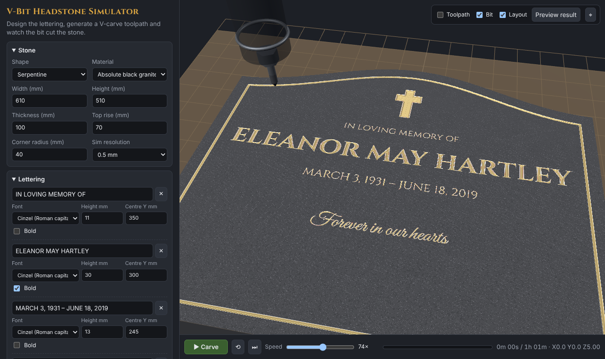

# V-Bit Headstone Simulator

A browser-based tool for designing headstone lettering, generating a V-carve
toolpath, and simulating a V-bit carving it into stone in 3D.



## Running it

No build step. Serve the folder with any static web server and open
`index.html`:

```bash
python3 -m http.server 8000
# then open http://localhost:8000
```

(Opening the file directly via `file://` won't work because browsers block ES
modules there.) Three.js is vendored in `vendor/`, so it works offline; the
memorial fonts load from Google Fonts when online and fall back to the browser's
serif font otherwise.

## What it does

1. **Stone**: pick a profile (serpentine, segmental arch, Roman half-round,
   gothic, peak, rounded or square top, heart), size, thickness and material
   (black / grey / red / blue-pearl granite, marble, sandstone).
2. **Design**: lines of lettering (memorial fonts such as Cinzel, EB Garamond,
   Great Vibes), an emblem (cross, Celtic cross, heart(s), Star of David, dove,
   rose), a carved border at a constant inset from the edge, and optional
   line-art from an uploaded image.
3. **Toolpath**: the design is rasterised and run through an exact Euclidean
   distance transform. A V-bit with included angle θ cuts to depth
   `z = D / tan(θ/2)`, where `D` is the distance to the nearest edge of the
   letter. Three strategies are available:
   - **V-carve (medial axis)**: follows the skeleton of each letter at that
     depth, which produces crisp sloped walls and sharp corners. When the
     depth hits *Max depth* the bottom goes flat, and extra offset passes
     clear it with the tip.
   - **Offset contours + axis**: iso-distance contours at the stepover, plus
     the medial-axis pass.
   - **Raster**: zig-zag rows following the depth map.

   The toolpath is split into **depth passes** (*Depth per pass*), which is
   how stone is usually cut.
4. **Simulation**: a height-field material-removal model sweeps the true
   bit geometry (a cone capped by the bit diameter) along every move. Play it
   at 1× to ~2500× real time, jump to the end, or click **Preview result** to
   see the ideal finished carve.
5. **Carved area colour**: show the letters left frosted, or filled with gold
   leaf, silver leaf, white or black paint, or any **custom colour**. Use the
   colour picker or the swatches (white, black, gold, silver, bronze, red,
   blue, green, grey), with an optional metallic finish. *Fill above depth*
   sets how deep a cut must be before it takes the paint; lower it so the
   shallow edges of small lettering get coloured too.
6. **G-code**: export the program (`G21`, absolute, origin at the bottom-left
   of the face, Z0 on the polished surface), or **load your own G-code**
   (G0/G1/G2/G3, G20/G21, G90/G91) to simulate a file from VCarve, Aspire,
   Fusion and so on with the selected bit.

## Toolpath optimization

On by default (*Toolpath optimization* panel); untick it to compare. The
stats panel shows the unoptimized run time, the time saved, and how many
cuts start with a lift versus a direct link.

- **Finish each letter before moving on**: all depth passes of one letter
  (connected area of the design) are cut before travelling to the next,
  instead of crossing the whole stone once per pass.
- **Nearest-neighbour ordering**: each next cut is the closest one to where
  the bit is, entered from whichever end is nearer.
- **Link nearby cuts without lifting**: if the next cut starts within *Max
  link distance*, the bit feeds straight to it. A link is only made when
  every point along it stays at or above the finished V-carve surface, so the
  cone stays inside the letter and the carved result is unchanged.
- **Retract height**: between cuts the bit lifts only to this height above
  the face; the full safe Z is used at the start and end of the program.

On the default headstone this cuts the estimated run time from about 61 to
46 minutes. A test simulating optimized and unoptimized programs for all
three strategies produced identical carved surfaces.

## Saving and loading settings

- **Save settings** downloads a `.headstone.json` file with every option:
  stone, lettering lines, emblem, border, bit, feeds, colours, view toggles
  and any uploaded artwork (stored inside the file).
- **Load settings…** opens a saved file and rebuilds the design and toolpath.
- The current settings are also kept automatically in this browser, so a
  reload picks up where you left off. **Reset** clears that copy and returns
  to the default design.

## Notes and limits

- Units are millimetres throughout.
- Sim resolution sets the cell size of the height field. 0.5 mm suits
  lettering down to about 10 mm tall; use 0.35 or 0.25 mm for small text.
- The run-time estimate assumes constant feed (no acceleration).
- A warning appears if *Max depth* is deeper than the cone of the chosen bit.

## Layout

| File | Purpose |
| --- | --- |
| `js/headstone.js` | Stone outline profiles |
| `js/design.js` | Rasterises lettering, emblem, border and artwork |
| `js/vcarve.js` | Distance transform, medial axis, contours, toolpaths, passes |
| `js/simulator.js` | Height-field material removal with the V-bit |
| `js/renderer.js` | Three.js scene, stone shader, bit and spindle |
| `js/gcode.js` | G-code export and import |
| `js/optimize.js` | Toolpath optimization (ordering, linking, retracts) |
| `js/settings.js` | Save / load settings (JSON file and browser storage) |
| `js/main.js` | UI wiring |
